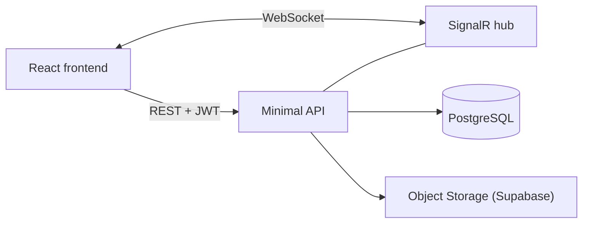

# Arhitektura in tehnološki sklad

## Arhitektura

- **Frontend:** React aplikacija v brskalniku.
- **Backend:** .NET Minimal API. Vsa poslovna logika in preverjanje pravic.
- **Podatkovna baza:** PostgreSQL, relacijski model iz `03-podatkovni-model.md`.
- **Datoteke:** PDF gradiva v namenskem oblačnem objektu (Object Storage, npr. Supabase Storage), v bazi je shranjena URL povezava ali ključ datoteke.
- **Komunikacija:** JSON prek HTTP (REST) z JWT žetonom. Za dogodke v živo WebSocket povezava (SignalR).

### WebSockets

- Novi odgovori v Q&A temi se pokažejo takoj.
- Avtor dobi obvestilo, ko tutor spremeni status njegovega gradiva.
- Povezava zahteva veljaven JWT.

### Avtentikacija
Prijava z e-pošto in geslom, geslo je zgoščeno. API vrne JWT z ID-jem in vlogo. Registrirajo se samo študenti, tutorje in administratorje določi administrator. Vloge se preverjajo na API-ju pri vsakem zahtevku.

### Lokalni zagon
Aplikacija se bo zaganjala lokalno preko vsebnika na dockerju

### Tehnološki sklad

| Del | Tehnologija |
| --- | --- |
| Frontend | React, Vite |
| Backend | ASP.NET Core Minimal API (C#) |
| Podatkovna baza | PostgreSQL |
| Dostop do baze | Entity Framework Core (ORM) ali raw SQL |
| Avtentikacija | JWT, gesla zgoščena |
| Realtime | SignalR (WebSockets) |
| Datoteke | Object Storage (Supabase) |
| Lokalni razvoj | dotnet CLI, npm, Docker |

### Arhitekturne odločitve
- **Monolitni backend:** Ker ima projekt jasen in omejen obseg, bi uvedba mikroservisov prinesla nepotrebno kompleksnost (upravljanje več storitev, mrežni zamiki, zapletena postavitev). Monolitna arhitektura omogoča hiter razvoj, enostavno testiranje in hitro postavitvene cikle.
- **PostgreSQL:** Ker aplikacija temelji na močno povezanih podatkih (uporabniki, predmeti, gradiva, rokovniki), relacijska baza zagotavlja podatkovno integriteto s tujimi ključi in preprečuje nekonzistentnost podatkov, hkrati pa ponuja industrijsko zanesljivost. +Poznavanje okolja
- **JWT (JSON Web Token):** Odpravlja odvisnost od zunanjih ponudnikov (Auth0/Firebase), njihove omejitve ter podvajanje uporabnikov v več bazah. Podatki niso preveč občutljivi
- **Objektno shranjevanje (Object Storage):**  Zunanji objektni shrambi (Supabase) zagotavljata varno, neodvisno in neodvisno skalabilno hrambo PDF gradiv.
- **SignalR (WebSockets):** Izbran je bil, ker je natančno integriran v ASP.NET Core ekosistem. Preprosti za uporabo v ekosistemu